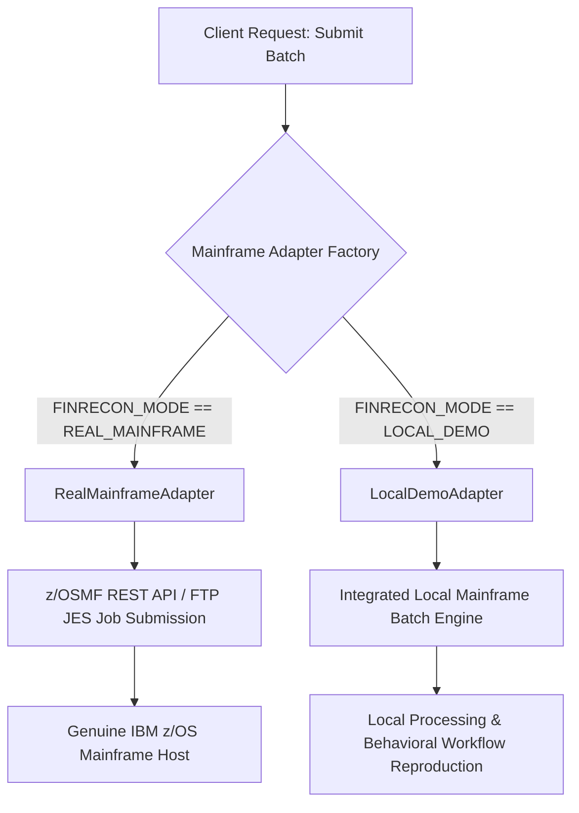
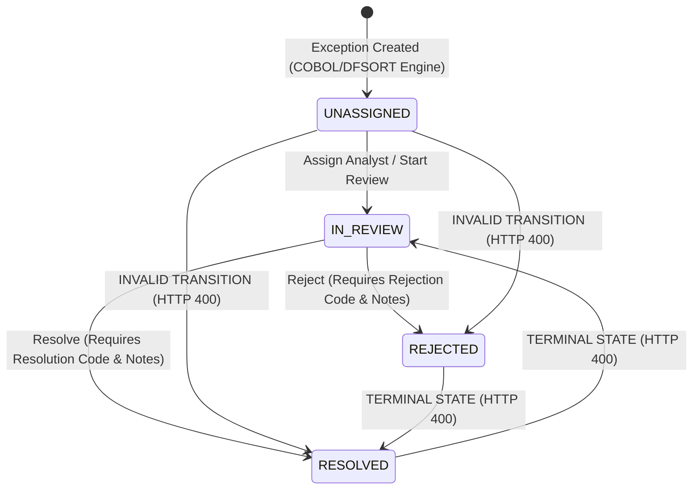

# FinRecon — Hybrid Enterprise System Architecture

## Architecture Overview

**FinRecon** is designed as a hybrid 3-tier enterprise financial reconciliation platform combining a modern **React / TypeScript Web UI**, a **FastAPI Python Orchestration Backend**, a **Dual-Mode Mainframe Adapter**, and an **IBM z/OS Mainframe Batch-Processing Engine**.

```
                ┌──────────────────────────────────────────┐
                │             FINRECON WEB UI              │
                │          (React 18 + TypeScript)         │
                │                                          │
                │ Operations Dashboard                     │
                │ Batch Processing Control                 │
                │ Transaction Ledger Search                │
                │ Exception Management Workspace           │
                │ Auditor Report Export Center             │
                │ Audit Trail Timeline                     │
                └────────────────────┬─────────────────────┘
                                     │ REST APIs / JSON
                                     ▼
                ┌──────────────────────────────────────────┐
                │               API BACKEND                │
                │           (FastAPI + Python)             │
                │                                          │
                │ Upload & Validation API                  │
                │ Batch Control & Status Polling API       │
                │ Exception Triage & Search API            │
                │ Server-Side RBAC Middleware              │
                │ Auditor Report Export Engine             │
                └────────────────────┬─────────────────────┘
                                     │
                                     ▼
                ┌──────────────────────────────────────────┐
                │            MAINFRAME ADAPTER             │
                │        (Dual-Mode Abstraction)           │
                │                                          │
                │ Mode 1: REAL_MAINFRAME                   │
                │ Mode 2: LOCAL_DEMO                       │
                └────────────────────┬─────────────────────┘
                                     │
                                     ▼
                ┌──────────────────────────────────────────┐
                │         MAINFRAME BATCH ENGINE           │
                │                                          │
                │ Master JCL                               │
                │ IBM DFSORT                               │
                │ Enterprise COBOL                         │
                │ TSO REXX                                 │
                │ Fixed-Length PS Datasets                 │
                └────────────────────┬─────────────────────┘
                                     │
                                     ▼
                ┌──────────────────────────────────────────┐
                │   PERSISTENCE, AUDIT & EXPORT OUTPUTS    │
                │ SQLite Operational Store (LOCAL_DEMO)     │
                │ Append-Only Audit Trail                  │
                │ CSV, XLSX, and PDF Reports               │
                └──────────────────────────────────────────┘
```

---

## Tier Responsibilities

### 1. Presentation Layer (Frontend — `frontend/`)
* **Technology**: React 18, TypeScript, Vite, TailwindCSS, Recharts, Lucide Icons.
* **Responsibilities**:
  * Render operational KPIs, batch pipeline status steps, transaction ledger search, and exception management drawers.
  * Prominently display active system execution mode (`MODE: LOCAL_DEMO` or `MODE: REAL_MAINFRAME`).
  * Enforce client-side input file validation before batch submission.
  * Render Demo Identity selector (`ANALYST_01`, `ANALYST_02`, `SUPERVISOR_01`) for testing RBAC rules.

### 2. Service & Adapter Layer (Backend — `backend/`)
* **Technology**: FastAPI, Pydantic v2, Uvicorn, SQLite (`data/finrecon_local.db`).
* **Responsibilities**:
  * Expose REST API endpoints for file validation, batch orchestration, batch status monitoring and API-based status polling, exception filtering, and operational audit logging.
  * Provide clean `MainframeAdapter` abstraction (`RealMainframeAdapter` vs `LocalDemoAdapter`).
  * Enforce server-side Role-Based Access Control (`ANALYST` vs `SUPERVISOR`).
  * Generate auditor-ready CSV, Excel (`openpyxl`), and PDF (`ReportLab`) report packages.
  * Route job requests without executing core financial business logic inside Python/JavaScript.

### 3. Processing Layer (Mainframe Engine — Root `cobol/`, `jcl/`, `rexx/` & `mainframe/` Archive)
* **Specification**: The Mainframe processing layer defines the authoritative JCL, DFSORT, COBOL, REXX, and fixed-length dataset processing rules.
  * In `REAL_MAINFRAME` mode, these workloads are intended for execution on IBM z/OS.
  * In `LOCAL_DEMO` mode, the local adapter behaviorally reproduces the defined processing workflow for demonstration and testing without claiming real z/OS execution.
* **Directory Purpose**:
  * Root `cobol/`, `jcl/`, `rexx/`: Active operational Mainframe source files used by the local demonstration adapter execution engine.
  * `mainframe/`: Historical Mainframe repository source archive and dataset storage mirroring original mainframe artefacts.

---

## Dual-Mode Mainframe Adapter Specification



* **`MODE 1: REAL_MAINFRAME`**:
  * Designed for connection to a genuine z/OS host via z/OSMF REST APIs or FTP JES job submission.
  * Submits JCL, queries z/OS job status, and streams output datasets.
  * In the current unconfigured demonstration environment, calling `RealMainframeAdapter` raises `NotImplementedError`. REAL_MAINFRAME execution was not tested.

* **`MODE 2: LOCAL_DEMO`**:
  * Explicitly labeled as `LOCAL_DEMO` on the Web UI.
  * `LOCAL_DEMO` provides a local execution environment that behaviorally reproduces the defined Mainframe processing workflow for demonstration and testing. It uses local processing and SQLite operational persistence (`finrecon_local.db`). It does not claim that a real z/OS job was executed on Windows.

---

## Faculty Assignment Mapping Matrix

| Assignment Module | Mainframe Artefact Path | Input Specification | Processing Specification | Output Specification |
| :--- | :--- | :--- | :--- | :--- |
| **Assignment 1** | `mainframe/jcl/SORT01.JCL`<br>`jcl/SORT01.JCL` | 100 recs, 80B, Key Cols 13–20 | DFSORT `SUM FIELDS=NONE`, Ascending Sort (`CH,A`) | 90 unique sorted recs (`FINRECON.WORK.BANK`) (`RC=00`) |
| **Assignment 2** | `mainframe/cobol/FINREC01.CBL`<br>`cobol/FINREC01.CBL` | Bank (50 recs, 80B, Key 13–20)<br>Merch (50 recs, 80B, Key 21–28) | COBOL 2-pointer parallel merge engine | 5 output streams (`MATCHED`, `EXCP`, `MISS`) (`RC=04`) |
| **Assignment 3** | `mainframe/rexx/FINREXX.REX`<br>`rexx/FINREXX.REX` | 120 recs, 100B, Key Cols 25–32 | REXX stem hash deduplication & in-memory sort | 105 unique sorted recs (`FINRECON.WORK.AUDIT`) (`RC=00`) |
| **Assignment 4** | `mainframe/jcl/VAL01PAS.JCL`<br>`mainframe/jcl/VAL02FAI.JCL` | 90 recs (`FINRECON.WORK.BANK`) | Descending sort copy & count validation | **Pass**: 90==90 -> Kept (`RC=00`)<br>**Fail**: 90!=89 -> Purged (`RC=12`) |

---

## Operational Exception Triage & Immutability Architecture

Phase 4 introduces an operational **Exception Management & Transaction Triage Layer** above the reconciliation engine.

### Financial Immutability Rule
Financial reconciliation results (`bank_amount`, `merchant_amount`, `amount_difference`, `reason_code`, `reconciliation_status`, and control totals) generated by the COBOL/DFSORT Mainframe layer are **READ-ONLY** and cannot be altered by operational triage actions. Triage actions modify only operational metadata (`triage_status`, `assigned_to`, `notes`, `resolution_code`, `resolution_notes`, `resolved_at`).

### Triage State Machine Diagram


### Operational Audit Trail
All triage actions produce append-only audit events logged via `AuditRepository`:
* `EXCEPTION_CREATED`: Automated exception generation from batch engine
* `EXCEPTION_ASSIGNED`: Case assigned to operational analyst
* `STATUS_CHANGED`: Transition to `IN_REVIEW`
* `NOTE_ADDED`: Append-only investigation note added
* `EXCEPTION_RESOLVED`: Terminal resolution with code and notes
* `EXCEPTION_REJECTED`: Terminal rejection with code and notes
* `SECURITY_DENIED`: Unauthorized operation attempt recorded
* `REPORT_EXPORTED`: Auditor export generated

---

## Audit, Security Hardening & Export Reporting Architecture

### 1. Persistent Operational Storage (SQLite for `LOCAL_DEMO` Mode)
* **Storage Layer**: SQLite (`data/finrecon_local.db`).
* **Role**: Embedded persistent store exclusively for `LOCAL_DEMO` operational triage state (investigation notes, assignee history, terminal resolutions, append-only audit trail).
* **Isolation**: Strictly separated from z/OS batch processing. Financial fields remain 100% read-only and immutable.

### 2. Server-Side Role-Based Access Control (RBAC)
```
               ┌──────────────────────────────────────────────┐
               │              CLIENT REQUEST                  │
               │   Headers: X-User-Name, X-User-Role          │
               └──────────────────────┬───────────────────────┘
                                      │
                                      ▼
               ┌──────────────────────────────────────────────┐
               │    get_user_context() Dependency             │
               │  Extract Identity & Role (ANALYST/SUPERVISOR) │
               └──────────────────────┬───────────────────────┘
                                      │
                 ┌────────────────────┴────────────────────┐
                 │                                         │
                 ▼                                         ▼
   [Read / Assign / Add Note]                  [Resolve / Reject / Export]
                 │                                         │
                 ▼                                         ▼
        Allowed for All                       Role == SUPERVISOR?
       (ANALYST & SUPERVISOR)                     /         \
                                                YES          NO
                                                 │            │
                                                 ▼            ▼
                                              Allowed     HTTP 403
                                                         Log SECURITY_DENIED
```

### 3. HTTP Security Hardening
* **Security Headers**:
  * `X-Content-Type-Options: nosniff`
  * `X-Frame-Options: DENY`
  * `Content-Security-Policy: default-src 'self'; img-src 'self' data:; style-src 'self' 'unsafe-inline'; script-src 'self' 'unsafe-inline' 'unsafe-eval';`
  * `Referrer-Policy: strict-origin-when-cross-origin`
  * `X-XSS-Protection: 1; mode=block` *(Legacy compatibility header included for legacy browser response alignment)*
* **CORS**: Restricted cross-origin resource sharing configured for authorized frontend origins (`http://localhost:5173`, `http://localhost:3000`).

### 4. Auditor Report Export Engine
* **Formats Supported**:
  1. **Exceptions CSV** (`/api/v1/reports/exceptions.csv`)
  2. **Audit Trail CSV** (`/api/v1/reports/audit.csv`)
  3. **Reconciliation Excel Workbook** (`/api/v1/reports/reconciliation.xlsx`): Multi-tab formatted workbook (`openpyxl`) featuring Executive Summary, Exception Register, Operational Audit Log, and Financial Control Totals.
  4. **Auditor Summary PDF Report** (`/api/v1/reports/reconciliation.pdf`): Professional print-ready PDF containing system metadata, financial control totals, exception cases, operational audit events, and execution-mode disclosure.

---

## Directory Structure Specification

```text
FinRecon/
├── README.md
├── PROJECT_AUDIT.md
├── ARCHITECTURE.md
├── TEST_PLAN.md
├── ADVANCED_FEATURES.md
├── PHASE6_FINAL_VALIDATION.md
├── DOCUMENTATION_AUDIT_REPORT.md
├── start_finrecon.bat
├── backend/
│   ├── app/
│   │   ├── adapters/
│   │   ├── api/
│   │   ├── core/
│   │   ├── db/
│   │   ├── models/
│   │   ├── repositories/
│   │   ├── services/
│   │   └── main.py
│   ├── data/
│   │   └── finrecon_local.db
│   ├── tests/
│   └── requirements.txt
├── cobol/
├── data/
├── docs/
├── frontend/
├── jcl/
├── mainframe/
│   ├── cobol/
│   ├── datasets/
│   ├── jcl/
│   ├── rexx/
│   └── sort/
├── reports/
├── rexx/
└── tests/
```

---

## Team & Contributors

- **Chirag Kochar**
- **Prem Palhade**
- **Zainab Pirjade**
