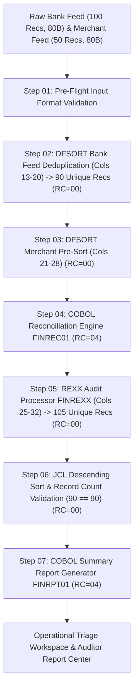
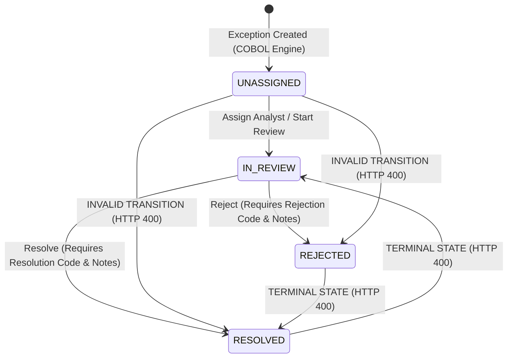

# FinRecon — Financial Transaction Processing & Automated Reconciliation Platform

A hybrid enterprise financial reconciliation platform combining a **React + TypeScript Web Dashboard**, **FastAPI Python Service Layer**, **Dual-Mode Mainframe Adapter**, and **IBM z/OS Mainframe Batch Processing Engine** (JCL, DFSORT, COBOL, REXX).

---

## Executive Overview

**FinRecon** automates financial transaction matching, discrepancy detection, monetary control-total validation, and operational exception triage across multi-bank and merchant processing feeds. 

The platform bridges legacy z/OS batch architectures with modern web interfaces. It preserves mandatory fixed-length dataset structures and mainframe business rules while providing dashboard visibility, API-based batch status monitoring, role-based operational triage, persistent audit logging, and auditor-ready export reporting.

---

## Problem Statement

Financial institutions process millions of daily transactions ingested from diverse banking networks and merchant payment gateways. These feeds often contain:
- **Duplicate Records**: Resubmitted or re-transmitted batch files.
- **Monetary Discrepancies**: Partial settlements, interchange fees, or rounding differences.
- **Status Mismatches**: Transactions marked approved in one ledger but rejected/cancelled in another.
- **Missing Items**: Records present in the bank ledger but missing from the merchant feed (or vice versa).
- **Control Total Imbalances**: Discrepancies between total input batch values and reconciled output balances.

Traditional systems log exceptions into static mainframe print datasets, requiring manual log parsing and lacking persistent investigation history, audit tracking, or granular access control.

---

## Primary Objectives

1. **Academic Assignment Compliance**: Satisfy 100% of z/OS faculty assignment requirements for fixed-length dataset processing, DFSORT deduplication (Assignment 1), COBOL 5-way reconciliation (Assignment 2), REXX audit processing (Assignment 3), and conditional JCL record-count validation (Assignment 4).
2. **Strict Financial Immutability**: Ensure core reconciliation outputs (`bank_amount`, `merchant_amount`, `amount_difference`, `reason_code`, control totals) remain read-only and immutable after batch execution.
3. **Operational Exception Triage**: Provide an operational management layer for analysts and supervisors to assign, review, investigate, and resolve exceptions without altering underlying financial results.
4. **Server-Side Security & RBAC**: Enforce Role-Based Access Control (`ANALYST` vs `SUPERVISOR`) server-side with HTTP 403 enforcement and security header hardening.
5. **Auditor-Ready Reporting**: Generate multi-format export documentation (CSV, multi-tab Excel workbooks, and print-ready PDF reports) with operational audit logging.

---

## Key Features

- ⚡ **Dual Execution Modes**: `LOCAL_DEMO` (local behavioral reproduction & SQLite persistence) and `REAL_MAINFRAME` (z/OS z/OSMF / JES job submission adapter).
- 📊 **Monetary Control Totals**: Automated accounting equation balancing ($\text{Bank Total} = \text{Matched} + \text{Discrepancies} + \text{Missing}$) and control-total validation.
- 🛠️ **Exception Triage State Machine**: Strict lifecycle state transitions (`UNASSIGNED` $\rightarrow$ `IN_REVIEW` $\rightarrow$ `RESOLVED` / `REJECTED`) with mandatory resolution codes and investigation notes.
- 🔒 **Server-Side RBAC Enforcement**: Role-based access control preventing unauthorized case resolutions or report downloads.
- 📑 **Auditor Export Engine**: On-demand generation of Exceptions CSV, Audit Trail CSV, multi-tab Excel workbooks (`openpyxl`), and Auditor Summary PDF reports (`ReportLab`).
- 🛡️ **HTTP Security Hardening**: Security headers (`X-Content-Type-Options: nosniff`, `X-Frame-Options: DENY`, `Content-Security-Policy`, `Referrer-Policy`) and CORS controls.
- 🚀 **Advanced Research & Innovation Features**:
  - **Feature A (Self-Healing Control & Batch Recovery)**: 8-stage checkpoint validation, state machine (`NORMAL` $\rightarrow$ `CONTROL_FAILURE` $\rightarrow$ `DIAGNOSING` $\rightarrow$ `RECOVERY_ATTEMPT` $\rightarrow$ `REVALIDATING` $\rightarrow$ `RECOVERED`), and automated stage replay.
  - **Feature B (Transaction Lineage Graph)**: End-to-end transaction provenance tracing (`INPUT_RECEIVED` $\rightarrow$ `EXPORTED`) and deterministic decision explanations.
  - **Feature C (Intelligent Hybrid Reconciliation)**: Secondary explainable similarity engine (`confidence_score`, feature vectors, `AUTO_MATCH` recommendations) augmenting primary Mainframe exact matching.

---

## System Architecture

```
                       ┌──────────────────────────────────────────────┐
                       │               FINRECON WEB UI                │
                       │     (React 18 + TypeScript + Vite)           │
                       │ Dashboard | Batch Control | Exceptions |     │
                       │ Ledger Search | Reports | Audit Trail        │
                       └──────────────────────┬───────────────────────┘
                                              │ REST APIs / JSON
                                              ▼
                       ┌──────────────────────────────────────────────┐
                       │               FASTAPI BACKEND                │
                       │        (Python 3.10+ / Pydantic v2)          │
                       │ Upload API | Batch API | Triage API |        │
                       │ RBAC Middleware | Report Generator           │
                       └──────────────────────┬───────────────────────┘
                                              │
                                              ▼
                       ┌──────────────────────────────────────────────┐
                       │              MAINFRAME ADAPTER               │
                       │          (Dual-Mode Abstraction)             │
                       │  ┌────────────────────┐ ┌──────────────────┐ │
                       │  │ LOCAL_DEMO Mode    │ │ REAL_MAINFRAME   │ │
                       │  └────────────────────┘ └──────────────────┘ │
                       └──────────────────────┬───────────────────────┘
                                              │
                                              ▼
 ┌────────────────────────────────────────────────────────────────────────────────────────┐
 │                                MAINFRAME BATCH ENGINE                                  │
 │                                                                                        │
 │  [MASTER.JCL] ──> [DFSORT] ──> [COBOL FINREC01] ──> [REXX FINREXX] ──> [JCL VALIDATE] │
 │  (Assign 1)       (Assign 1)   (Assign 2)           (Assign 3)         (Assign 4)      │
 └────────────────────────────────────────────┬───────────────────────────────────────────┘
                                              │
                                              ▼
                       ┌──────────────────────────────────────────────┐
                       │     PERSISTENCE & REPORTING OUTPUTS          │
                       │  SQLite (LOCAL_DEMO) | Audit Log             │
                       │  CSV Exports | XLSX Workbooks | PDF Reports  │
                       └──────────────────────────────────────────────┘
```

---

## Processing Workflow



---

## Mainframe Assignment Mapping

| Module / Assignment | Mainframe Artefacts | Input Specification | Processing Specification | Output Specification & Return Code |
| :--- | :--- | :--- | :--- | :--- |
| **Assignment 1** | `SORT01.JCL`<br>`FINRECON.INPUT.BANK` | 100 recs, 80 Bytes, FB, Key Cols 13–20 | DFSORT `SUM FIELDS=NONE`, Ascending Sort (`CH,A`) | 90 unique sorted records (`FINRECON.WORK.BANK`) (`RC=00`) |
| **Assignment 2** | `FINREC01.CBL`<br>`RECON01.JCL` | Bank (50 recs, 80B, Key 13–20)<br>Merch (50 recs, 80B, Key 21–28) | COBOL 2-pointer parallel merge algorithm | 5 reconciliation streams (`MATCHED`, `EXCP`, `MISSING`) (`RC=04`) |
| **Assignment 3** | `FINREXX.REX`<br>`REXX01.JCL` | 120 recs, 100 Bytes, FB, Key Cols 25–32 | TSO REXX stem hash deduplication & in-memory sort | 105 unique sorted records (`FINRECON.WORK.AUDIT`) (`RC=00`) |
| **Assignment 4** | `VAL01PAS.JCL`<br>`VAL02FAI.JCL` | 90 recs (`FINRECON.WORK.BANK`) | Descending sort copy & input vs. output count check | **Pass**: 90==90 -> Kept (`RC=00`)<br>**Fail**: 90!=89 -> Purged (`RC=12`) |

---

## Exception Management & Triage

Phase 4 introduces an operational triage lifecycle layer operating strictly above the core reconciliation results.



### Standardized Reason Codes

| Reason Code | Description | Severity | Reconciliation Category |
| :--- | :--- | :--- | :--- |
| **`RCN-000`** | Matched Transaction | `LOW` | Matched |
| **`RCN-101`** | Amount Mismatch (Discrepancy $\ge \$1,000$ $\rightarrow$ `CRITICAL`, $< \$1,000$ $\rightarrow$ `HIGH`) | `CRITICAL` / `HIGH` | Discrepancy |
| **`RCN-102`** | Status Mismatch (Bank=AP, Merchant=RJ) | `HIGH` | Discrepancy |
| **`RCN-103`** | Missing in Bank Feed | `CRITICAL` | Missing |
| **`RCN-104`** | Missing in Merchant Feed | `CRITICAL` | Missing |
| **`RCN-105`** | Duplicate Transaction Detected | `MEDIUM` | Duplicate |

### Financial Field Immutability

> [!IMPORTANT]
> Financial reconciliation results (`bank_amount`, `merchant_amount`, `amount_difference`, `reason_code`, `reconciliation_status`, and control totals) generated by the COBOL batch engine are **100% READ-ONLY** and cannot be altered by operational triage actions. Triage actions modify only operational metadata (`triage_status`, `assigned_to`, `notes`, `resolution_code`, `resolution_notes`, `resolved_at`).

---

## Security & Role-Based Access Control (RBAC)

FinRecon enforces server-side Role-Based Access Control (RBAC) across all API endpoints:

- **`ANALYST` Role**: Permitted to view dashboards, search transactions, filter exceptions, assign cases to self/others, and append investigation notes. Restricted from resolving/rejecting cases or downloading export reports.
- **`SUPERVISOR` Role**: Full operational privileges, including case resolution/rejection and generating auditor reports.
- **Server-Side Enforcement**: Requests by `ANALYST` attempting restricted status transitions or report exports are rejected with `HTTP 403 Forbidden` and logged as `SECURITY_DENIED` audit events.
- **Security Response Headers**: HTTP responses enforce `X-Content-Type-Options: nosniff`, `X-Frame-Options: DENY`, `Content-Security-Policy`, `Referrer-Policy: strict-origin-when-cross-origin`, and legacy `X-XSS-Protection: 1; mode=block` headers.

---

## Financial Control Totals & Monetary Balancing

The platform validates monetary balancing using the financial accounting control equation:

$$\text{Bank Source Total} = \text{Matched Amount} + \text{Amount Mismatch Amount} + \text{Status Mismatch Amount} + \text{Missing Merchant Amount}$$

$$\$62,525.00 = \$37,515.00 + \$6,252.50 + \$6,252.50 + \$12,505.00 \quad \checkmark \text{ (BALANCED)}$$

If total input monetary amount does not equal total output monetary amount, the system flags a monetary balancing discrepancy (`RC=12`).

---

## Reporting & Exports

FinRecon includes an auditor-ready reporting engine supporting four export formats:

1. **Exceptions CSV Export** (`/api/v1/reports/exceptions.csv`): Tabular export of all transaction discrepancies, reason codes, severities, and triage statuses.
2. **Audit Trail CSV Export** (`/api/v1/reports/audit.csv`): Complete append-only operational audit log featuring event IDs, timestamps, actors, roles, and status changes.
3. **Reconciliation Excel Workbook** (`/api/v1/reports/reconciliation.xlsx`): Multi-tab workbook (`openpyxl`) featuring Executive Summary, Exception Register, Operational Audit Log, and Financial Control Totals.
4. **Auditor Summary PDF Report** (`/api/v1/reports/reconciliation.pdf`): Professional print-ready PDF document (`ReportLab`) featuring system metadata header, financial control totals table, exception breakdown, and execution-mode disclosure.

---

## Technology Stack

| Layer | Technologies Used |
| :--- | :--- |
| **Frontend UI** | React 18, TypeScript, Vite, TailwindCSS, Recharts, Lucide Icons |
| **Backend API** | Python 3.10+, FastAPI, Pydantic v2, Uvicorn |
| **Operational Persistence** | SQLite (`data/finrecon_local.db`) for `LOCAL_DEMO` operational triage state |
| **Mainframe Processing** | z/OS JCL, IBM DFSORT, IBM Enterprise COBOL, TSO REXX, Fixed-Length PS Datasets |
| **Report Generation** | `openpyxl` (Excel), `reportlab` (PDF), Python Standard `csv` |
| **Automated Testing** | `pytest`, FastAPI `TestClient`, Python Standard `unittest` |

---

## Project Structure

```text
FinRecon/
├── README.md                           <-- Master Project Documentation
├── PROJECT_AUDIT.md                    <-- Complete Final Project Audit & Implementation Status
├── ARCHITECTURE.md                     <-- System Architecture Specification
├── TEST_PLAN.md                        <-- Master Test Plan & Final Validation Report
├── start_finrecon.bat                  <-- 1-Click Windows Local Startup Batch Script
├── backend/
│   ├── app/
│   │   ├── adapters/                   <-- Dual-Mode Mainframe Adapter (LocalDemo & RealMainframe)
│   │   ├── api/                        <-- FastAPI REST Routes & RBAC Dependencies
│   │   ├── core/                       <-- Application Settings & Configuration
│   │   ├── db/                         <-- SQLite Persistent Operational Storage
│   │   ├── models/                     <-- Pydantic Data Models & Enums
│   │   ├── repositories/               <-- SQLite Exception & Audit Repositories
│   │   ├── services/                   <-- Reconciliation & Report Generator Services
│   │   └── main.py                     <-- FastAPI Main Application Entrypoint
│   ├── data/
│   │   └── finrecon_local.db           <-- LOCAL_DEMO Operational SQLite Store
│   ├── tests/                          <-- Backend API Unit Tests
│   └── requirements.txt                <-- Python Dependencies
├── cobol/                              <-- Active COBOL Source Files
│   ├── FINREC01.CBL                    <-- COBOL 5-Way Reconciliation Engine
│   └── FINRPT01.CBL                    <-- COBOL Management Summary Report Generator
├── data/
│   ├── generate_data.py                <-- Fixed-Length Synthetic Dataset Generator
│   ├── FINRECON.INPUT.BANK.txt         <-- Bank Input Feed (100 Recs, 80 Bytes, FB)
│   ├── FINRECON.INPUT.MERCHANT.txt     <-- Merchant Input Feed (50 Recs, 80 Bytes, FB)
│   ├── FINRECON.INPUT.AUDIT.txt        <-- Audit Input Feed (120 Recs, 100 Bytes, FB)
│   ├── test_assignment1.py             <-- Assignment 1 Standalone Test Harness
│   ├── test_assignment2.py             <-- Assignment 2 Standalone Test Harness
│   ├── test_assignment3.py             <-- Assignment 3 Standalone Test Harness
│   ├── test_assignment4.py             <-- Assignment 4 Standalone Test Harness
│   └── test_assignment5_report.py      <-- Project Report Generator Test Harness
├── docs/
│   ├── ARCHITECTURE.md                 <-- System Architecture Specification
│   ├── TEST_CASES.md                   <-- Test Case Execution Matrix
│   └── VSAM_DB2_ARCHITECTURE.md        <-- VSAM KSDS & DB2 Specifications
├── frontend/
│   ├── src/
│   │   ├── components/                 <-- UI Components (Header, Sidebar, Navigation)
│   │   ├── pages/                      <-- Dashboard, Batch, Transactions, Exceptions, Reports Pages
│   │   ├── services/                   <-- Frontend API Client & HTTP Interceptors
│   │   ├── types/                      <-- TypeScript Data Interfaces
│   │   ├── App.tsx                     <-- React Main App Component
│   │   └── main.tsx                    <-- React Entrypoint
│   ├── package.json                    <-- Node.js Dependencies & Build Scripts
│   ├── tsconfig.json                   <-- TypeScript Compiler Configuration
│   └── vite.config.ts                  <-- Vite Bundler Configuration
├── jcl/                                <-- Active JCL Execution Jobs
│   ├── MASTER.JCL                      <-- Master Pipeline Orchestration JCL
│   ├── SORT01.JCL                      <-- Assignment 1 Standalone DFSORT Job
│   ├── RECON01.JCL                     <-- Assignment 2 Standalone COBOL Job
│   ├── REXX01.JCL                      <-- Assignment 3 Standalone REXX Job
│   ├── VAL01PAS.JCL                    <-- Assignment 4 Pass Scenario Job
│   └── VAL02FAI.JCL                    <-- Assignment 4 Fail Scenario Job
├── mainframe/                          <-- Historical Mainframe Source Archive (Mirror)
│   ├── cobol/
│   ├── datasets/
│   ├── jcl/
│   ├── rexx/
│   └── sort/
├── reports/                            <-- Staged Report Output Directory
├── rexx/                               <-- Active REXX Source Files
│   └── FINREXX.REX                     <-- Assignment 3 REXX Audit Processor
└── tests/                              <-- Integration & System Test Suites
    ├── test_phase3_controls.py
    ├── test_phase4_triage.py
    └── test_phase5_security_export.py
```

---

## Execution Modes

FinRecon provides a dual-mode adapter architecture:

### `LOCAL_DEMO` Mode
> [!NOTE]
> `LOCAL_DEMO` provides a local execution environment that behaviorally reproduces the defined Mainframe processing workflow for demonstration and testing. It uses local processing and SQLite operational persistence (`finrecon_local.db`). It does not claim that a real z/OS job was executed on Windows.

### `REAL_MAINFRAME` Mode
> [!NOTE]
> `REAL_MAINFRAME` is designed for genuine IBM z/OS integration via the `MainframeAdapter` abstraction. When configured with an active z/OS host connection, it submits JCL jobs via z/OSMF REST APIs or JES FTP job submission. In the current unconfigured demonstration environment, calling `RealMainframeAdapter` raises `NotImplementedError`. REAL_MAINFRAME execution was not tested in this local environment.

---

## Installation & Setup

### Prerequisites
- **Python**: Python 3.10 or higher
- **Node.js**: Node.js v18 or higher (with `npm`)

### 1. Backend Setup
```powershell
# Navigate to backend directory
cd backend

# Install Python dependencies
pip install -r requirements.txt
```

### 2. Frontend Setup
```powershell
# Navigate to frontend directory
cd frontend

# Install Node.js dependencies
npm install
```

---

## Running the Application

### Option A: 1-Click Startup (Windows)
Double-click `start_finrecon.bat` in the project root directory. It automatically launches both backend and frontend servers in separate windows.

### Option B: Manual Startup (Two Terminals)

**Terminal 1 — FastAPI Backend**:
```powershell
cd backend
python -m uvicorn app.main:app --host 127.0.0.1 --port 8000 --reload
```

**Terminal 2 — React Frontend**:
```powershell
cd frontend
npm run dev
```

Open your browser to: **[`http://localhost:5173`](http://localhost:5173)**

---

## Automated Testing & Validation

Run all automated test suites to verify system health:

```powershell
# Run complete Pytest test suite (61 automated tests — 61/61 PASSED)
python -m pytest tests/ backend/tests/ -v
```

Run standalone test harnesses:
```powershell
python data/test_assignment1.py        # Assignment 1: RC=00 (DFSORT 100 -> 90)
python data/test_assignment2.py        # Assignment 2: RC=04 (COBOL Reconciliation)
python data/test_assignment3.py        # Assignment 3: RC=00 (REXX 120 -> 105)
python data/test_assignment4.py        # Assignment 4: RC=00 (Pass) & RC=12 (Fail)
python data/test_assignment5_report.py  # Project Report Generator: RC=04
```

Verify frontend production build:
```powershell
cd frontend
npm run build
```

---

## Manual End-to-End Validation Evidence

The complete system workflow has been manually verified:

1. **System Health Check**: API ONLINE (`MODE: LOCAL_DEMO`, Service: FinRecon, Version: 2.0.0).
2. **File Validation**: Input datasets (`FINRECON.INPUT.BANK.txt`, `FINRECON.INPUT.MERCHANT.txt`, `FINRECON.INPUT.AUDIT.txt`) validated for fixed-length formatting (80B and 100B).
3. **Batch Pipeline Execution**: Pipeline steps `STEP01` through `STEP07` completed successfully (`MAXCC=04`).
4. **Transaction Search**: Transaction `TXN10001` inspected and verified as `MATCHED` (`RCN-000`).
5. **Operational Triage**: Exception `EXC-10031` / `TXN10031` investigated.
6. **Analyst Review**: `ANALYST_01` assigned case and added investigation notes.
7. **RBAC Denial**: `ANALYST_01` resolution attempt correctly rejected with `HTTP 403 Forbidden` and `SECURITY_DENIED` logged.
8. **Supervisor Resolution**: `SUPERVISOR_01` resolved case with resolution code `RESOLVED_DATA_CORRECTION` and mandatory notes.
9. **Report Export**: CSV, Excel (`.xlsx`), and PDF (`.pdf`) auditor reports generated and verified.

---

## Verified Dashboard State

Manually verified operational metrics after batch execution and initial triage:

- **Bank Input Records Read**: 50 records ($62,525.00)
- **Merchant Input Records Read**: 50 records ($63,772.50)
- **Matched Transactions**: 30 records ($37,515.00)
- **Total Exceptions Generated**: 30 records (5 Amount Mismatches, 5 Status Mismatches, 20 Missing)
- **Open Operational Cases**: 29 cases
- **Resolved Operational Cases**: 1 case
- **Total Audit Events Logged**: 41 events
- **Open Financial Exposure**: $26,008.00 *(Operational triage metric representing exposure of remaining open cases)*
- **Accounting Control Equation**: `BALANCED (PASS)`
- **Control Total Validation**: `PASSED (RC=00)`
- **DFSORT Duplicates Removed**: 10 bank duplicates, 15 audit duplicates

---

## Export Verification

All four auditor export formats have been generated and manually verified:

- **Exceptions CSV** (`exceptions.csv`): Tabular export of all 30 exceptions with reason codes, severities, and triage statuses.
- **Audit Trail CSV** (`audit.csv`): Full append-only log of operational events, actors, timestamps, and status changes.
- **Reconciliation Excel Workbook** (`reconciliation.xlsx`): 4-sheet workbook featuring Executive Summary, Exception Register, Audit Log, and Control Totals.
- **Auditor Summary PDF Report** (`reconciliation.pdf`): Print-ready PDF report featuring system metadata, control total tables, exception breakdown, and execution-mode disclosure.

---

## Known Limitations

1. **`REAL_MAINFRAME` Integration**: Requires a configured IBM z/OS host environment and is unconfigured in the current local demonstration setup.
2. **`LOCAL_DEMO` Persistence**: Uses embedded SQLite (`finrecon_local.db`) for operational state management rather than an enterprise mainframe database.
3. **Demo Identity Selector**: The frontend identity switcher is a demonstration mechanism for testing RBAC rules and is not an enterprise Single Sign-On (SSO) implementation.
4. **SQLite Scope**: SQLite is strictly used for operational triage state in `LOCAL_DEMO` mode and is not presented as the production system of record for Mainframe financial data.
5. **Demonstration Environment**: The platform is an academic/enterprise demonstration platform and is not connected to live production banking networks.

---

## Academic Assignment Compliance

| Assignment | Requirement | Implementation Artefact | Verification Status |
| :--- | :--- | :--- | :--- |
| **Assignment 1** | Process 100 recs (80B, Key 13-20), remove 10 dups, output 90 sorted recs. | `SORT01.JCL` / `DFSORT` | **PASS (`RC=00`)** |
| **Assignment 2** | Read File1 (50 recs, Key 13-20) & File2 (50 recs, Key 21-28), reconcile 5 categories via COBOL. | `FINREC01.CBL` / `RECON01.JCL` | **PASS (`RC=04`)** |
| **Assignment 3** | Process 120 recs (100B, Key 25-32), remove 15 dups via REXX stem hash, sort in-memory. | `FINREXX.REX` / `REXX01.JCL` | **PASS (`RC=00`)** |
| **Assignment 4** | Descending sort copy, compare input vs output count. Keep file on match, delete on mismatch. | `VAL01PAS.JCL` & `VAL02FAI.JCL` | **PASS (`RC=00` Pass / `RC=12` Fail)** |

---

## Future Integration Opportunities

- **z/OSMF REST API Integration**: Complete live z/OS job submission, spool retrieval, and dataset streaming via `RealMainframeAdapter`.
- **Enterprise SSO / OAuth2**: Integrate OpenID Connect / SAML 2.0 authentication replacing the demo identity selector.
- **DB2 / VSAM Integration**: Migrate operational triage store to DB2 for z/OS or VSAM KSDS datasets.

---

## Author & Project Information

- **Project Name**: FinRecon — Financial Transaction Processing & Automated Reconciliation Platform
- **Architecture**: Hybrid z/OS Mainframe Batch & Web Platform
- **Implementation**: Phases 1–6 completed
- **Status**: Completed — LOCAL_DEMO validated; REAL_MAINFRAME integration unconfigured

### Team & Contributors
- **Chirag Kochar**
- **Prem Palhade**
- **Zainab Pirjade**
